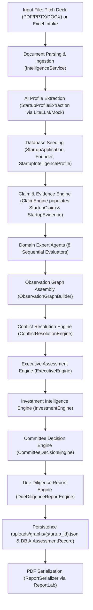

# Current Agent Inventory & Architecture Audit

**TIDES-AI Startup Evaluation Platform**  
**Repository State:** `release/v1.0.0` at commit `b0fbc67840422a218934785682353dba1280f442`  
**Date:** October 2026  
**Status:** Audit & Architecture Baseline (Read-Only)

---

## 1. Executive Summary & Verification Context

This document captures the exact implementation state of all AI agents, evaluation engines, orchestration pipelines, data schemas, and persistence mechanisms in the TIDES-AI platform.

### Verified Environment & Commit Status
- **Current Branch**: `release/v1.0.0`
- **Current HEAD**: `b0fbc67840422a218934785682353dba1280f442` (`chore: sync latest TIDES-AI workstation progress`)
- **Working Tree**: Clean (`nothing to commit, working tree clean`)
- **Database**: Local SQLite database preserved at `tides_ai.db` (3,149,824 bytes)
- **Local Artifacts**: Local pitch decks and metadata preserved in `uploads/` (239 startup application folders)
- **Environment**: `.env` (501 bytes) exists and is protected from disclosure

---

## 2. Agent Codebase Topology: Two Distinct Agent Subsystems

The repository contains two distinct agent subsystems that must not be conflated:

```
┌────────────────────────────────────────────────────────────────────────┐
│                        TIDES-AI Codebase Topology                      │
└────────────────────────────────────────────────────────────────────────┘
                                    │
          ┌─────────────────────────┴─────────────────────────┐
          ▼                                                   ▼
┌───────────────────────────────────┐       ┌───────────────────────────────────┐
│     ACTIVE PRODUCTION SYSTEM      │       │     LEGACY / EXPERIMENTAL SYSTEM  │
│    (TIE: TIDES Intelligence)      │       │      (Minimalist Agent Stubs)     │
├───────────────────────────────────┤       ├───────────────────────────────────┤
│ • app.modules.evaluation          │       │ • app.modules.ai.agents           │
│   - 8 Domain Expert Agents        │       │   - BaseAgent                     │
│   - ObservationGraph & Engines    │       │   - EchoAgent                     │
│   - ContextBuilder & Filters      │       │   - FounderAgent (stub)           │
│ • app.services.ai.gateway         │       │   - MarketAgent (stub)            │
│   - LiteLLMGateway                │       │   - ProductAgent (stub)           │
│   - MockAIGateway                 │       │ • app.modules.ai.gateway          │
│ • app.modules.ai.orchestrator     │       │   - Multi-provider gateway        │
│   - pipeline.py                   │       │   - Used only in isolated tests   │
└───────────────────────────────────┘       └───────────────────────────────────┘
```

1. **Active Evaluation System (`app.modules.evaluation` & `app.services.ai.gateway`)**:
   - The production evaluation pipeline used by FastAPI routers (`app/api/routers/evaluation.py`).
   - Comprises 8 specialized `ExpertAgent` subclasses, an `ObservationGraphBuilder`, deterministic aggregation and decision engines (`ConflictResolutionEngine`, `ExecutiveEngine`, `InvestmentEngine`, `CommitteeDecisionEngine`, `DueDiligenceReportEngine`), and `ReportSerializer`.
   - Driven by `app.services.ai.gateway.create_ai_gateway()` with `LiteLLMGateway` (production) and `MockAIGateway` (testing/zero-cost).

2. **Legacy / Isolated Experimental System (`app.modules.ai.agents` & `app.modules.ai.gateway`)**:
   - Located in `app/modules/ai/agents/` (`BaseAgent`, `EchoAgent`, `FounderAgent`, `MarketAgent`, `ProductAgent`).
   - These are lightweight string-in/string-out stubs inheriting from `BaseAgent` and tested in `tests/test_ai_orchestration/`.
   - They are **not** invoked during the actual startup due diligence or evaluation workflows.

---

## 3. Inventory of the 8 Domain Expert Agents

All 8 active expert agents inherit from `ExpertAgent` (`app/modules/evaluation/expert_agent.py`), execute via `complete_json()` from `app.services.ai.gateway`, and generate an `AgentAssessment` validated by `AssessmentValidator`.

| Expert Class | Source File | Domain Key | Context Filter | Prompt Directory | Version |
| :--- | :--- | :--- | :--- | :--- | :--- |
| **`FounderExpert`** | `app/modules/evaluation/founder_expert.py` | `"founder"` | `FounderContextFilter` | `app/modules/evaluation/prompts/founder` | `1.0.0` |
| **`ProductExpert`** | `app/modules/evaluation/product_expert.py` | `"product"` | `ProductContextFilter` | `app/modules/evaluation/prompts/product` | `1.0.0` |
| **`MarketExpert`** | `app/modules/evaluation/market_expert.py` | `"market"` | `MarketContextFilter` | `app/modules/evaluation/prompts/market` | `1.0.0` |
| **`FinancialExpert`** | `app/modules/evaluation/financial_expert.py` | `"financial"` | `FinancialContextFilter` | `app/modules/evaluation/prompts/financial` | `1.0.0` |
| **`TRLExpert`** | `app/modules/evaluation/trl_expert.py` | `"trl"` | `TRLContextFilter` | `app/modules/evaluation/prompts/trl` | `1.0.0` |
| **`CompetitionExpert`** | `app/modules/evaluation/competition_expert.py` | `"competition"` | `CompetitionContextFilter` | `app/modules/evaluation/prompts/competition` | `1.0.0` |
| **`IPExpert`** | `app/modules/evaluation/ip_expert.py` | `"ip"` | `IPContextFilter` | `app/modules/evaluation/prompts/ip` | `1.0.0` |
| **`RiskExpert`** | `app/modules/evaluation/risk_expert.py` | `"risk"` | `RiskContextFilter` | `app/modules/evaluation/prompts/risk` | `1.0.0` |

---

## 4. Input and Output Schemas

### 4.1 Input Contract to `ExpertAgent.evaluate(...)`
```python
def evaluate(
    self,
    profile: StartupIntelligenceProfile,
    claims: list[StartupClaim],
    evidence: list[StartupEvidence],
    conflicts: list[FieldConflict],
    metadata: dict[str, Any]
) -> AgentAssessment:
```
1. **Filtering**: `ContextBuilder.build_context()` uses the expert's registered `BaseContextFilter` (e.g. `FounderContextFilter`) to isolate relevant claims, evidence snippets, and field conflicts.
2. **Context Serialization**: `generate_reasoning()` serializes claims, evidence IDs, snippets, section names, page numbers, and conflict history into a structured textual block (`context_str`).
3. **Prompt Assembly**: Loads prompt from `PromptManager.load_prompt(domain, "latest")` (`system.md` and `user.md`).

### 4.2 Output Contract: `AgentAssessment` (`app/modules/evaluation/schemas.py`)
```python
class AgentAssessment(BaseModel):
    domain: str                                   # e.g. "founder", "market"
    summary: str                                  # High-level overview
    observations: list[Observation]               # Structured expert observations (with claim/evidence links)
    risks: list[Risk]                             # Categorized risks (Critical, High, Medium, Low)
    questions: list[Question]                     # Follow-up questions for founders
    confidence: ConfidenceHierarchy               # finding, evidence, reasoning, overall confidence (0.0-1.0)
    reasoning: str                                # Detailed analytical breakdown
    missing_evidence: list[MissingEvidence]       # Unmet documentation needs
    
    # Explicit VC Due Diligence additions:
    executive_conclusion: str                     # Executive conclusion statement
    strengths: list[str]                          # List of domain strengths
    weaknesses: list[str]                         # List of domain weaknesses
    investment_implication: str                   # Milestone or deal-structuring implication
    missing_information: list[str]                # Missing facts/data
    follow_up_questions: list[str]                # Flat list of queries
    
    # Traceability & Provenance:
    prompt_name: str
    prompt_version: str
    prompt_hash: str                              # SHA-256 hash of prompt template
    agent_version: str
    generated_at: datetime
```

---

## 5. End-to-End Evaluation Workflow Trace

The active evaluation workflow operates across two main execution paths:
1. **Synchronous End-to-End Orchestrator**: `POST /api/v1/evaluate-startup` in `app/api/routers/evaluation.py` calling `coordinate_evaluation_pipeline` in `app/modules/ai/orchestrator/pipeline.py`.
2. **Asynchronous Background Task Service**: `POST /api/v1/evaluate` & `POST /api/v1/evaluate/{startup_id}` calling `EvaluationService.evaluate_startup` in `app/api/dependencies.py`.

### Detailed Step-by-Step Execution Sequence



### Stage Breakdown

1. **Document Intake & Ingestion**:
   - `DocumentService.upload()` saves file under `uploads/{startup_id}/{file_id}_{name}`.
   - `IntelligenceService.process_document()` invokes format parsers (`PDFParser`, `PPTXParser`, `DOCXParser`, `PlainTextParser`) from `app/modules/intelligence/parsers.py`.
   - Extracted text stored in `Document.parsed_text`.

2. **AI Profile Extraction (`StartupProfileExtraction`)**:
   - Executes via `create_ai_gateway().complete_json(req, StartupProfileExtraction)`.
   - Extracts atomic fields: `company_name`, `founders`, `founder_roles`, `problem_statement`, `solution`, `technology`, `patents`, `market`, `market_size`, `business_model`, `revenue_model`, `competition`, `traction`, `team`, `financial_information`, `funding_ask`, `funding_raised`, `current_revenue`, `burn_rate`, `runway`.

3. **Intake Mapping & Claim Engine**:
   - `ClaimEngine.process_extraction()` converts extracted strings to `StartupClaim` records linked to canonical `RegistryField` keys, generating supporting `StartupEvidence` records with page references and confidence scores.

4. **Multi-Agent Domain Evaluation**:
   - Sequentially executes all 8 expert agents:
     `FounderExpert`, `ProductExpert`, `MarketExpert`, `FinancialExpert`, `TRLExpert`, `CompetitionExpert`, `IPExpert`, `RiskExpert`.
   - Each expert loads its prompt from `PromptManager`, queries the AI gateway for structured JSON (`AgentAssessment`), and validates the draft against claims via `AssessmentValidator`.

5. **Knowledge Graph Construction (`ObservationGraph`)**:
   - `ObservationGraphBuilder.build(profile, claims, evidence, assessments, conflicts)` compiles domain observations, risks, questions, and evidence links into a connected graph structure (`ObservationGraph`).

6. **Conflict Resolution (`ConflictResolutionEngine`)**:
   - Resolves factual, numeric, temporal, and consensus contradictions between domain assessments.
   - Creates resolution nodes in the graph and suppresses contradictory lower-confidence observations.

7. **Executive & Investment Engines**:
   - `ExecutiveEngine.generate(graph)`: Compiles unified executive narrative, sector benchmarking, and key takeaways.
   - `InvestmentEngine.generate(graph)`: Calculates deterministic investment score (0–100), composite confidence, and primary recommendation (`RECOMMENDED`, `CONDITIONAL`, `REJECTED`, `MORE_INFO_REQUIRED`).

8. **Committee Decision Engine (`CommitteeDecisionEngine`)**:
   - Determines final incubation recommendation (`INCUBATE`, `DEFER`, `REJECT`, `PENDING_DD`) and assigns conditions, tranches, and milestone requirements.

9. **Report Generation & PDF Serialization**:
   - `DueDiligenceReportEngine.generate(graph)` compiles 14 distinct markdown sections.
   - `ReportSerializer.export_pdf_data(graph.report)` renders professional binary PDF via `reportlab.platypus` (PageBreak, ParagraphStyle, Tables).

10. **Persistence**:
    - Serialized graph saved to `uploads/graphs/{startup_id}.json`.
    - Portfolio index updated in `uploads/graphs/portfolio.json`.
    - Status and decision persisted in database tables (`StartupProcessingStatus`, `StartupApplication.current_status`, `AIAssessmentRecord`).

---

## 6. Excel / Accubate Intake System

- **File**: `app/modules/intake/service.py` (`ExcelIntakeService`)
- **Route**: `POST /api/v1/intake/upload-applications`
- **Supported Format**: `.xlsx` workbook using `openpyxl`.
- **Expected Columns**: `Startup Name`, `Founder Name`, `Founder Email`, `Problem Statement`, `Solution`, `Target Market`, `Startup Stage`.
- **Database Records Created**:
  - `StartupApplication`
  - `Founder` (name, email)
  - `StartupProfile` & `StartupProfileVersion` (initial version capturing problem, solution, market)
  - `StartupStatusHistory` (initial intake event)

---

## 7. AI Gateway Architecture & Configuration

### 7.1 Services-Layer Gateway (`app/services/ai/gateway.py`)
- Used exclusively by the active evaluation pipeline and extractor.
- Factory function: `create_ai_gateway(*, settings=None, force_mock=False) -> AIGateway`.
- Controlled by `app.core.config.Settings`:
  - `AI_ENABLED` (boolean, default: `False`)
  - `AI_PROVIDER` (string: `"mock"` or `"litellm"`, default: `"mock"`)
  - `LITELLM_MODEL` (string, default: `"claude-sonnet-5-5"`)
  - `AI_REQUEST_TIMEOUT_SECONDS` (int, default: `120`)
  - `AI_MAX_RETRIES` (int, default: `2`)
  - `ANTHROPIC_API_KEY` (string, optional)

### 7.2 Providers
- **`MockAIGateway` (`app/services/ai/mock.py`)**:
  - Zero external network calls, zero API credit consumption.
  - Deterministically returns valid Pydantic models (`StartupProfileExtraction`, `AgentAssessment`, `DocumentExtraction`).
  - Essential for regression testing, local CI, and development baselines.
- **`LiteLLMGateway` (`app/services/ai/litellm.py`)**:
  - Calls LiteLLM `completion()` with model specified by `LITELLM_MODEL`.
  - Injects JSON schema into system prompt to enforce valid JSON across providers.
  - Detects retryable server errors (503, 429, timeouts) with exponential backoff (`2 ** attempt`).
  - Strips Markdown code blocks (` ```json `), validates via `json.loads` and Pydantic `model_validate`.

---

## 8. Existing Test Suite Mapping

The repository has 44 test files in `tests/`. The following table maps test suites directly to the components audited above:

| Component Under Test | Primary Test File(s) | Execution Mode |
| :--- | :--- | :--- |
| **AI Gateway & Retries** | `tests/test_ai_gateway.py` | Unit (mocked LiteLLM & MockAIGateway) |
| **AI Document Extraction** | `tests/test_ai_extraction.py`, `tests/test_document_intelligence.py` | Unit / Mock Gateway |
| **Claim & Evidence Engine** | `tests/test_claim_engine.py`, `tests/test_intelligence_foundation.py` | SQLite in-memory / Mock DB |
| **Domain Expert Agents** | `tests/test_founder_expert.py`<br>`tests/test_product_expert.py`<br>`tests/test_market_expert.py`<br>`tests/test_financial_expert.py`<br>`tests/test_trl_expert.py`<br>`tests/test_competition_expert.py`<br>`tests/test_ip_expert.py`<br>`tests/test_risk_expert.py` | Unit with MockAIGateway |
| **Observation Graph & Builder** | `tests/test_observation_graph.py` | Graph structure & node validation |
| **Conflict Resolution Engine** | `tests/test_conflict_resolution.py` | Rule resolution & edge assertions |
| **Executive & Investment Engines** | `tests/test_executive_engine.py`, `tests/test_investment_engine.py` | Deterministic scoring tests |
| **Committee Decision Engine** | `tests/test_committee_engine.py` | Recommendation matrix tests |
| **Report Generation & Validation** | `tests/test_due_diligence_report.py`, `tests/test_report_generation.py`, `tests/test_report_builder.py`, `tests/test_report_validation.py` | Section rendering & schema assertions |
| **PDF Serialization** | `tests/test_report_export.py` | Binary PDF generation validation |
| **Excel / Accubate Intake** | `tests/test_intake.py` | Openpyxl workbook parsing & DB seeding |
| **End-to-End Orchestrator** | `tests/test_end_to_end_integration.py`, `tests/test_assess_endpoint.py` | Mock-backed end-to-end flow |
