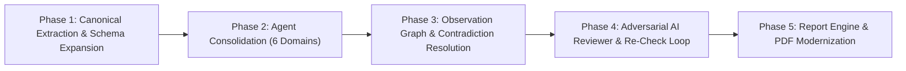

# Implementation Roadmap & Verification Strategy

**TIDES-AI Startup Evaluation Platform**  
**Phase 2:** Engineering Implementation Roadmap  
**Status:** Planning & Phasing Specification (Read-Only)

---

## 1. Implementation Phasing Strategy

To ensure zero downtime, preserve existing database data, and prevent regression of working capabilities, implementation is structured into five distinct sequential phases.

---

### Phase 1: Canonical Extraction & Schema Expansion
- **Objective**: Expand the ingestion pipeline so that all 87 LaunchIndex criteria are extracted and linked to source evidence before agent execution begins.
- **Key Deliverables**:
  1. Expand `StartupProfileExtraction` in `app/modules/ai/orchestrator/startup_profile_extraction.py` into 6 domain-aligned sub-models.
  2. Update `ClaimEngine` to map all 87 criteria to canonical `RegistryField` keys.
  3. Ensure evidence page numbers, bounding text, and extraction confidence are captured for every criterion.
  4. Expand `ExcelIntakeService` to accept extended application columns when present in spreadsheet intake batches.
- **Dependencies**: None. Can be implemented and verified in isolation with unit tests.
- **Verification Gate**: 100% test coverage using `MockAIGateway` with zero paid API calls.

---

### Phase 2: Agent Consolidation into 6 Specialized Domains
- **Objective**: Restructure existing 8 agents into the 6 LaunchIndex domain evaluators.
- **Key Deliverables**:
  1. **Domain 1**: Merge `ProductExpert` and `TRLExpert` into `ProblemSolutionExpert` (`app/modules/evaluation/problem_solution_expert.py`). Add conditional prototype evaluation.
  2. **Domain 2**: Merge `MarketExpert` and `CompetitionExpert` into `MarketOpportunityExpert` (`app/modules/evaluation/market_opportunity_expert.py`). Enforce the 3-competitor requirement (including international).
  3. **Domain 3**: Adapt `FounderExpert` into `FounderTeamExpert`. Support multi-founder lists, LinkedIn verification, and advisor evaluation.
  4. **Domain 4**: Create `CommercialisationExpert` for business models, CAC/payback, first ₹10L roadmap, and distinguishing signed pilot contracts from MOUs.
  5. **Domain 5**: Adapt `IPExpert` into `InnovationImpactExpert`. Incorporate non-patent defensibility (data moats, network effects) and UN SDG alignment.
  6. **Domain 6**: Adapt `FinancialExpert` into `FinancialsSupportExpert`. Add 3-year projections, break-even timing, TIDES physical lab/mentorship needs, and 6-quarter roadmaps.
  7. Formulate corresponding system and user prompt templates in `app/modules/evaluation/prompts/`.
- **Dependencies**: Phase 1 (requires expanded claims and context filters).
- **Verification Gate**: All 6 agents pass `validate_inputs()`, `evaluate()`, and Pydantic validation via `MockAIGateway`.

---

### Phase 3: Observation Graph & Contradiction Resolution
- **Objective**: Update graph building and automated conflict detection to handle the enriched 6-domain output contracts.
- **Key Deliverables**:
  1. Update `ObservationGraphBuilder` to ingest `DomainAssessmentReport` instances.
  2. Extend `ConflictResolutionEngine` with domain cross-checking rules:
     - Commercial claims vs financial R&D spend.
     - Prototype claims vs documented engineering team capability.
     - Revenue projections vs market capture percentages.
  3. Reposition `RiskExpert` as a post-domain cross-cutting risk aggregator and deduplicator.
- **Dependencies**: Phase 2 (requires 6-domain outputs).
- **Verification Gate**: Graph builder creates valid connected DAGs without isolated nodes; conflict engine detects simulated synthetic contradictions.

---

### Phase 4: Adversarial AI Reviewer & Targeted Re-Check Loop
- **Objective**: Introduce the supervisory AI review stage to challenge unsupported claims and request targeted re-checks.
- **Key Deliverables**:
  1. Implement `SupervisoryReviewAgent` (`app/modules/evaluation/supervisory_review_agent.py`).
  2. Implement the targeted re-check orchestrator:
     - Detects material unsupported findings.
     - Calls only the affected domain agent with specific challenger instructions.
     - Merges updated findings without rerunning the remaining 5 agents.
  3. Integrate the deterministic `CommitteeDecisionEngine` with reviewer evidence findings.
- **Dependencies**: Phase 3 (requires complete `ObservationGraph`).
- **Verification Gate**: Synthetic tests demonstrating a triggered re-check loop resolving a flagged unsubstantiated claim.

---

### Phase 5: Due Diligence Report Engine & PDF Modernization
- **Objective**: Modernize the human-readable Markdown and PDF reports to present the 6 LaunchIndex domains seamlessly.
- **Key Deliverables**:
  1. Update `DueDiligenceReportEngine` to generate 14 structured report sections cleanly organized by the 6 domains.
  2. Update `ReportSerializer.export_pdf_data()`:
     - Enhanced typography, section breaks, and executive callout styling.
     - Color-coded risk tables (Critical, High, Medium, Low).
     - Full footnote citations linking claims to deck slide numbers.
  3. Update frontend visualization components if necessary to render the 6 domains.
- **Dependencies**: Phase 4 (requires final review output).
- **Verification Gate**: Generated PDF matches visual design standards, produces valid binary stream, and passes end-to-end regression tests.

---

## 2. Testing & Quality Assurance Strategy

To ensure strict engineering discipline, testing adheres to the following principles:

### Zero-Cost Development Baseline
- **Primary Tool**: `MockAIGateway` (`app/services/ai/mock.py`).
- All unit, regression, and CI tests run against deterministic mock completions.
- **No live API credits** (Anthropic, OpenAI, LiteLLM) are consumed during automated test execution.

### Test Categories & Suites

| Test Suite Category | Target Components | Strategy & Tools |
| :--- | :--- | :--- |
| **1. Schema Validation Tests** | Pydantic contracts (`CriterionAssessment`, `DomainAssessmentReport`, `FinalReviewAssessment`) | Verify schema enforcement, edge-case validation, null handling, and type safety. |
| **2. Unit Tests per Agent** | 6 Domain Specialist Agents | Inject synthetic claims and evidence; verify that prompts load correctly and output passes `AssessmentValidator`. |
| **3. Re-Check Loop Tests** | Targeted Re-Check Orchestrator | Verify that a simulated evidence contradiction triggers a re-check only for the target agent, preserving other results. |
| **4. Graph Integrity Tests** | `ObservationGraphBuilder`, `ConflictResolutionEngine` | Verify graph acyclicity, node-edge referential integrity, and proper node suppression. |
| **5. PDF Export Regression Tests** | `ReportSerializer` | Verify binary PDF generation, letter page sizing, styling, and text cleanliness without crashes. |
| **6. Backward Compatibility Tests** | Existing database records & API endpoints | Verify that existing startup profiles and saved graphs in `uploads/graphs/` load without schema migration errors. |

---

## 3. Implementation Risks & Mitigations

| Identified Risk | Severity | Potential Impact | Engineering Mitigation |
| :--- | :---: | :--- | :--- |
| **1. Context Window & Latency Inflation** | High | Running 6 deep agents + review stage could increase evaluation time and token costs. | • Use `ContextBuilder` domain filters to pass only relevant claims and evidence to each agent. • Run the 6 domain agents in parallel (`asyncio.gather`) where inputs are independent. |
| **2. Infinite Re-Check Loops** | Medium | Supervisory reviewer repeatedly challenging an unsubstantiated claim. | • Hard-limit re-checks to a maximum of 1 iteration per domain. • If evidence remains missing, record as `UNSUPPORTED_ASSUMPTION` rather than re-querying. |
| **3. Schema Drift with Historical Records** | High | Old graphs stored in `uploads/graphs/` failing to deserialize after schema updates. | • Maintain backward-compatible deserializers in `graph_serializer.py` with fallback defaults for missing new fields. |
| **4. Accidental Production API Usage** | High | Incurring unintended LLM API costs during testing. | • Enforce `AI_PROVIDER=mock` in all test fixtures and environment overrides. • Add assertion guards in `LiteLLMGateway` preventing network requests during test runs. |
| **5. Data Overwrite during Merge/Deploy** | Critical | Losing local database state (`tides_ai.db`) or existing pitch decks in `uploads/`. | • Keep all application state and database files out of git tracking or backed up before code modifications. • Use non-destructive Alembic migrations only. |
