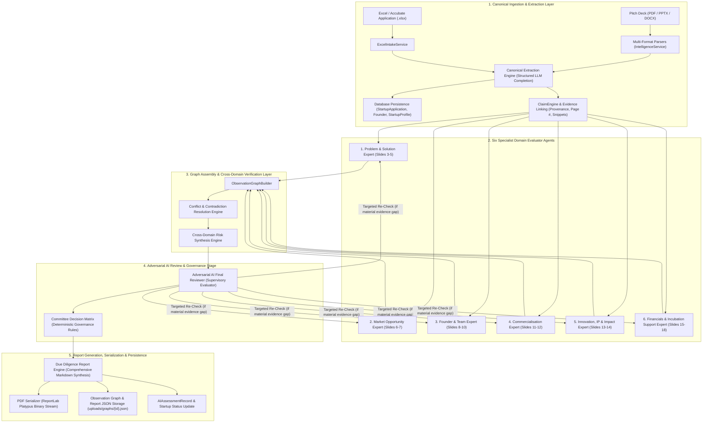

# Target Architecture & Standard Output Contracts

**TIDES-AI Startup Evaluation Platform**  
**Phase 2:** Canonical Target Architecture Specification  
**Status:** Design Proposal (Read-Only)

---

## 1. End-to-End Evaluation Architecture

The target architecture aligns the entire ingestion, extraction, agent evaluation, verification, and reporting lifecycle with the 6 core domains of the **LaunchIndex Startup Incubation Application Pitch Deck**.



---

## 2. Detailed Workflow Pipeline

### Stage 1: Intake & Extraction
1. **Multi-Channel Ingestion**: Accepts raw presentation decks (PDF, PPTX), documents (DOCX, TXT), or structured spreadsheet batches (.xlsx from Accubate).
2. **Canonical Extraction**: Extracts all 87 canonical criteria defined in `canonical_criteria_registry.md` into structured Pydantic models.
3. **Evidence Provenance**: Maps every fact to a `StartupClaim` with exact source page numbers, document snippets, and extraction confidence.
4. **Gap Identification**: Identifies missing, optional, and conflicting data before any evaluator runs.

### Stage 2: Six Specialist Domain Evaluators
Each specialist agent runs with domain-specific boundaries, prompt templates, and evaluation guidelines:
1. **`ProblemSolutionExpert`**: Analyzes the core problem (`PS-01`), affected personas (`PS-02`), workarounds (`PS-03`), 3 features and benefits (`PS-07`), UVP (`PS-08`), architecture (`PS-12`), and conditional prototype/TRL progress (`PS-09` to `PS-11`).
2. **`MarketOpportunityExpert`**: Analyzes TAM/SAM/SOM (`MO-01` to `MO-03`), market growth CAGR (`MO-04`), market drivers (`MO-05`), and conducts deep benchmarking against the required 3 competitors (`MO-07` to `MO-09`).
3. **`FounderTeamExpert`**: Evaluates all co-founders (`FT-01`, `FT-06`), verified LinkedIn profiles (`FT-02`), technical vs commercial credentials, skill gaps (`FT-08`), hiring roadmap (`FT-09`), and named advisors (`FT-10`).
4. **`CommercialisationExpert`**: Evaluates monetization mechanics (`BC-01`), pricing unit economics (`BC-02`), CAC/margin payback (`BC-04` to `BC-06`), path to first ₹10L / $10k (`BC-07`), paying customers vs trials (`BC-08`), and signed pilot contracts vs non-binding MOUs (`BC-10`).
5. **`InnovationImpactExpert`**: Evaluates non-patent proprietary defensibility (`II-01`), data advantages (`II-02`), network effects (`II-03`), switching costs (`II-04`), patent filings (`II-07`), and UN SDG alignment with measurable targets (`II-08` to `II-11`).
6. **`FinancialsSupportExpert`**: Audits 3-year revenue/margin/headcount forecasts (`FI-01` to `FI-04`), monthly burn rate (`FI-05`), break-even timing (`FI-06`), optional funding history (`FI-08`), TIDES IIT Roorkee physical lab & mentorship needs (`FI-10` to `FI-15`), and the 6-quarter operational roadmap (`FI-16` to `FI-19`).

### Stage 3: Graph Assembly & Contradiction Resolution
- The `ObservationGraphBuilder` combines all domain outputs into an interconnected DAG.
- The `ConflictResolutionEngine` identifies factual contradictions (e.g. `CommercialisationExpert` claims ₹50L revenue while `FinancialsSupportExpert` records ₹0 revenue in Year 1).

### Stage 4: Adversarial AI Final Review Stage
- **Role**: Operates as a senior Investment Committee Partner reviewing the draft assessments.
- **Verification of Evidence**: Tests whether domain conclusions are rigorously supported by evidence citations or are resting on unsupported founder assertions.
- **Targeted Re-Check Loop**: If a critical finding rests on ambiguous or conflicting evidence, the reviewer can request an isolated, targeted re-check from that specific domain agent without restarting the entire pipeline.
- **Committee Decision Matrix**: Pairs AI reasoning with institutional governance rules to produce the final recommendation (`INCUBATE`, `DEFER`, `REJECT`, `CONDITIONAL`).

### Stage 5: Serialization & Persistence
- Generates a 14-section comprehensive due diligence markdown report.
- Renders an official branded PDF via `reportlab.platypus` with tables, executive callouts, and evidence footnotes.
- Persists all graph states to `uploads/graphs/{startup_id}.json` and database assessment records.

---

## 3. Standard Output Contracts (Design Specifications)

> [!NOTE]
> The Pydantic schemas below are **design specifications** for target implementation. They do not alter existing application code in this audit phase.

### 3.1 Shared Criterion Assessment Contract
Every criterion evaluated by any domain agent adheres to this unified contract:

```python
from enum import Enum
from typing import Any, Optional
from pydantic import BaseModel, Field


class VerificationStatus(str, Enum):
    VERIFIED_DOCUMENTED = "VERIFIED_DOCUMENTED"        # Backed by explicit deck/document evidence
    SELF_REPORTED_ONLY = "SELF_REPORTED_ONLY"          # Claimed by founder without supporting proof
    PLAUSIBLE_ESTIMATE = "PLAUSIBLE_ESTIMATE"          # Logical inference backed by industry benchmarks
    CONTRADICTED = "CONTRADICTED"                      # Contradicts another slide or known fact
    UNSUPPORTED_ASSUMPTION = "UNSUPPORTED_ASSUMPTION"  # Unsubstantiated leap of faith
    MISSING_INFORMATION = "MISSING_INFORMATION"        # Required criterion not provided in application
    NOT_APPLICABLE = "NOT_APPLICABLE"                  # Conditional field legitimately skipped


class CriterionAssessment(BaseModel):
    criterion_id: str = Field(..., description="Canonical ID (e.g. 'PS-01', 'MO-07')")
    criterion_name: str = Field(..., description="Human-readable criterion title")
    extracted_startup_response: Optional[str] = Field(None, description="Exact atomic data extracted from application")
    assessment_narrative: str = Field(..., description="Analytical evaluation and domain reasoning")
    evidence_ids: list[str] = Field(default_factory=list, description="IDs of supporting StartupEvidence records")
    source_locations: list[str] = Field(default_factory=list, description="Slide numbers, section headers, or page references")
    verification_status: VerificationStatus = Field(..., description="Factual verification grade")
    strengths: list[str] = Field(default_factory=list, description="Specific identified domain strengths")
    weaknesses: list[str] = Field(default_factory=list, description="Deficiencies, gaps, or unresolved questions")
    risks: list[str] = Field(default_factory=list, description="Identified failure modes or threats")
    contradictions: list[str] = Field(default_factory=list, description="Inconsistencies with other criteria or slides")
    confidence_score: float = Field(..., ge=0.0, le=1.0, description="Evaluator certainty score (0.0 to 1.0)")
    confidence_limitations: Optional[str] = Field(None, description="Why confidence is less than 1.0 (e.g. lack of external audit)")
    score: Optional[float] = Field(None, description="Score populated only when authorized rubric is configured")
```

### 3.2 Shared Domain Assessment Report Contract
All 6 specialist agents return this standard domain report:

```python
from datetime import datetime


class DomainAssessmentReport(BaseModel):
    domain_key: str = Field(..., description="One of: 'problem_solution', 'market_opportunity', 'founder_team', 'commercialisation', 'innovation_impact', 'financials_support'")
    domain_title: str = Field(..., description="Official domain display name")
    executive_summary: str = Field(..., description="2-3 paragraph domain synthesis")
    criteria_evaluations: dict[str, CriterionAssessment] = Field(..., description="Map of criterion_id to CriterionAssessment")
    key_strengths: list[str] = Field(default_factory=list, description="Top domain strengths")
    key_risks: list[str] = Field(default_factory=list, description="Prioritized domain risks with severity")
    critical_unanswered_questions: list[str] = Field(default_factory=list, description="Must-answer queries for incubation committee")
    incubation_support_recommendations: list[str] = Field(default_factory=list, description="How TIDES can assist or derisk this domain")
    composite_domain_confidence: float = Field(..., ge=0.0, le=1.0)
    agent_version: str = Field(..., description="Agent implementation version")
    prompt_version: str = Field(..., description="Prompt template version")
    generated_at: datetime = Field(default_factory=datetime.utcnow)
```

### 3.3 Target Final Due Diligence Report Contract
The contract produced after adversarial review, conflict resolution, and committee scoring:

```python
class FinalReviewAssessment(BaseModel):
    report_id: str = Field(..., description="Unique report identifier (e.g. 'DD-TIDES-2026-0042')")
    startup_id: str = Field(..., description="Unique startup UUID")
    startup_name: str = Field(...)
    sector: str = Field(...)
    stage: str = Field(...)
    evaluation_timestamp: datetime = Field(default_factory=datetime.utcnow)
    
    # Domain Summaries
    domain_reports: dict[str, DomainAssessmentReport] = Field(..., description="6 domain reports")
    
    # Cross-Domain Synthesis
    cross_domain_findings: list[str] = Field(..., description="Cross-cutting observations linking multiple domains")
    identified_contradictions: list[dict[str, Any]] = Field(default_factory=list, description="Reconciled and unreconciled contradictions")
    composite_risk_matrix: list[dict[str, Any]] = Field(..., description="Deduplicated cross-domain risks ranked by severity")
    
    # Reviewer Challenge & Re-Check Audit Log
    rechecks_triggered: list[dict[str, Any]] = Field(default_factory=list, description="Log of targeted domain re-checks executed")
    material_unsupported_claims: list[str] = Field(default_factory=list, description="Founder assertions challenged for lack of proof")
    
    # Committee Decision & Rationale
    overall_recommendation: str = Field(..., description="'INCUBATE', 'DEFER', 'REJECT', or 'CONDITIONAL'")
    recommendation_rationale: str = Field(..., description="Defensible institutional rationale for the decision")
    incubation_conditions: list[str] = Field(default_factory=list, description="Milestones or governance conditions required before onboarding")
    recommended_tranches: list[dict[str, Any]] = Field(default_factory=list, description="Suggested funding or resource tranches")
    
    # Scoring (populated when approved rubric is active)
    investment_score: Optional[float] = Field(None, ge=0.0, le=100.0)
    confidence_score: float = Field(..., ge=0.0, le=1.0)
```
